  

  
  
  
  
  

 

Hey there, I'm a **machine learning researcher** and a **full-stack software engineer** based in Dhaka, Bangladesh.

My research applies deep learning to medical image analysis, mainly hybrid CNN–RNN models for
diagnosing lung disease from chest X-rays. In industry, I build production web platforms end to
end, from async Python APIs and databases to Next.js frontends, CI/CD and AWS deployments.
Working on both sides means my research code is built to be run, tested and reproduced, not
just to produce a result once.

- 🎓 B.Sc. in [Computer Science and Engineering].
- 🔬 Research collaboration with the **C2SG group, United International University**
- 💼 Full-Stack Engineer at **Ternary Solutions**, building production SaaS platforms
- 🌱 Interested in: medical image analysis · trustworthy ML in healthcare · ML systems in production

> **On affiliation:** I did my published research with the C2SG group at United International
> University while studying at BRAC University, so the paper lists UIU as the affiliation.

 

## 🔬 Research

<table>
<tr>
<td width="50%" valign="top">

### Lung Disease Recognition with CNN–RNN

**Enhancing lung diseases recognition through CNN-RNN methodologies** 
*[Nature], [2026]*

A hybrid model that classifies chest X-rays as COVID-19, lung opacity, viral pneumonia or
normal. A CNN extracts spatial features and an LSTM models dependencies across image patches.

📊 **93.73% accuracy · 94.6% macro-F1** on the COVID-19 Radiography Database (~21k images)

</td>
<td width="50%" valign="top">

### Exoplanet Mass–Radius Relations

**A Regime-Based Empirical Study** 
*Independent research*

Fits mass–radius relations across planet size regimes and examines which transiting
exoplanets are likely to retain water.

</td>
</tr>
</table>

 

## 🛠️ Engineering

I ship production software as part of a team: typed APIs, relational schemas and migrations,
background workers, automated tests and CI/CD, and infrastructure as code.

<table>
<tr>
<td width="50%" valign="top">

**Backend**
- Async REST APIs with FastAPI, SQLAlchemy 2 and PostgreSQL
- Auth (JWT, password hashing, rate limiting), role-based access
- Celery + Redis background jobs and transactional email
- Alembic migrations that deploy safely with zero downtime

</td>
<td width="50%" valign="top">

**Frontend & DevOps**
- Next.js (App Router), React and TypeScript with Tailwind
- Unit tests (Vitest) and end-to-end tests (Playwright)
- Docker, GitHub Actions CI/CD
- AWS (ECS, RDS, S3) managed with Terraform

</td>
</tr>
</table>

### Featured projects

| Project | Description | Stack |
| --- | --- | --- |
| [docker-ci-cd-app](https://github.com/ZahinZee/docker-ci-cd-app) | Containerised Python app with an automated CI/CD pipeline | Python · Docker · GitHub Actions |
| [authentication_app](https://github.com/ZahinZee/authentication_app) | Authentication service with secure login flows | Python |
| [webhook-tester](https://github.com/ZahinZee/webhook-tester) | Captures and inspects incoming webhook payloads | Python |

 

## 🧰 Tech stack

**Machine learning**  

  

**Full-stack & cloud**  

 

 

  Open to research collaborations and graduate research opportunities in medical imaging and applied ML.

